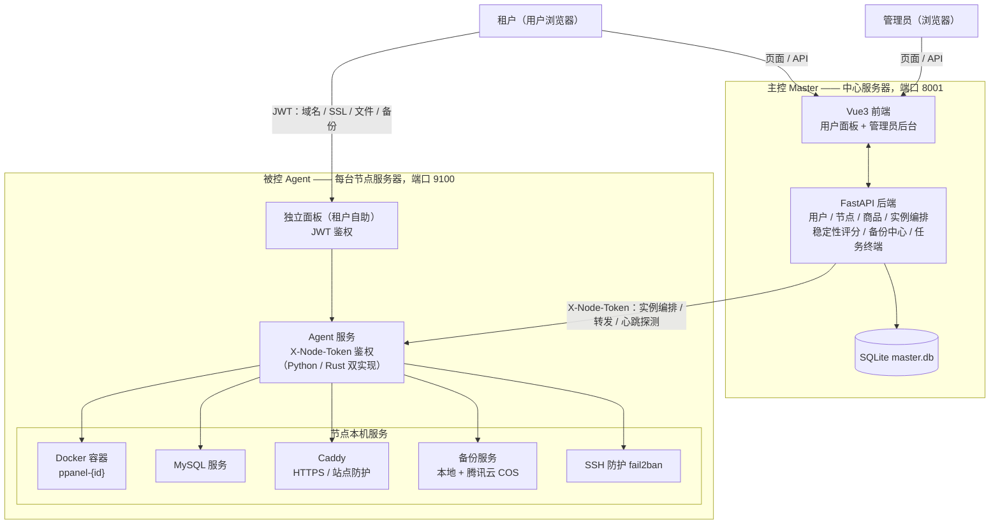

# PPanel

多租户售卖型云面板：一台中心服务器（主控）+ N 台节点服务器（被控），面向个人开发者开通、售卖和管理容器化建站实例。租户拿到实例后拥有一个功能完整的「独立面板」，可自助管理域名、SSL、数据库、文件与备份。

## 核心特性

**商城与实例**

- 商品管理 + 商城对接（webhook 自动开通），四维规格：CPU / 内存 / 月流量 / 有效期
- 多运行时实例：PHP / Node / Python / Go，开箱即用（示例入口文件 + 默认启动命令）
- 按实例的流量计量（Docker 网络增量采样、自然月重置、超 85% 告警）
- 容器 `unless-stopped` 自愈：进程崩溃 / OOM / 宿主机重启后秒级自动拉起

**独立面板（租户自助）**

- 域名绑定 + SSL：Caddy 自动申请 / 续期 Let's Encrypt 证书
- 数据库：MySQL 开通、phpMyAdmin 临时容器（2 小时自动回收）
- 文件管理：在线编辑 / 预览 / 右键操作
- 网站防护：密码保护（basic_auth）、IP 黑白名单、静态站点托管
- 备份：整库 / 表级备份（.sql.gz）、容器目录备份（.tar.gz）、定时任务、下载 / 恢复
- 依赖管理：npm / pnpm（Node）、go mod tidy + GOPROXY 加速（Go）

**管理员后台**

- 节点管理：Docker 概况、实例清单、SSH 防护（fail2ban）、稳定性评分
- 系统运维：按节点查看整机负载、进程、systemd 服务（可启停 / 自启）、监听端口、journald 日志、SSH 登录审计
- 告警中心：节点离线 / 磁盘 / 内存 / 服务异常 / 实例反复崩溃 / 响应缓慢，支持 Webhook（钉钉 / 企业微信 / 飞书 / 通用 JSON）与邮件通知
- 备份中心：不进节点即可备份 / 恢复任意节点数据，支持本地 + 腾讯云 COS 双目的地
- 实例管理：删除、归属节点、搜索、稳定运行时长（停止归零）
- 任务终端：耗时操作（备份 / 恢复 / Docker / 开通实例）实时日志滚动反馈

**稳定性评分**：心跳采集（60s）+ 实例事件记账，四维加权 —— 崩溃率 40% / 在线率 25% / 资源水位 20% / 服务异常 15%，输出分数与等级徽标。

**告警中心**：复用同一份心跳数据，在主控侧做规则判定，被控无需改动。同一告警未恢复期间只记一条（去重），指标回落自动置为已恢复，恢复后再次触发会新开一条以保留历史。阈值、离线判定次数、崩溃窗口、重复通知间隔均可在后台调整；通知发送与数据库写入分离（网络 I/O 不占事务），未配置渠道时告警照常落库供后台查看。

| 规则 | 触发条件 | 默认阈值 |
| --- | --- | --- |
| 节点离线 | 连续 N 次心跳失败 | 2 次（60s/次） |
| 磁盘空间不足 | 节点磁盘使用率超阈值 | 85% 警告 / 92% 紧急 |
| 内存占用过高 | 节点内存使用率超阈值 | 90% 警告 / 96% 紧急 |
| 节点服务异常 | 心跳 detail 报告 Docker 不可用等 | — |
| 实例反复崩溃 | 窗口内崩溃次数达阈值 | 30 分钟内 3 次 |
| 节点响应缓慢 | 心跳延迟超阈值 | 3000ms |

## 架构



- **主控与被控**之间通过 HTTP + `X-Node-Token` 通信：主控下发实例编排、转发 Docker / WebSocket / 宿主机操作，并每 60 秒心跳探测用于稳定性评分。
- **租户与独立面板**之间使用 JWT（`Authorization: Bearer` 或 `?t=` 传参），到期后自动降级为只读模式。
- **宿主机管理 API**（备份、SSH 防护）支持 `X-Node-Token` / `X-API-Key` 双凭证鉴权。

## 术语约定

| 术语 | 含义 |
| --- | --- |
| 主控 | 中心端整体（管理员面板 + 用户面板），Windows 开发环境跑 8001 |
| 被控 | `installer/install.sh` 安装的 Agent（9100 端口），管理单台服务器 |
| 独立面板 | 被控上租户使用的自助界面（域名 / SSL / 数据库 / 文件 / 备份） |
| 节点面板 | 管理员在主控里打开的节点管理弹窗（Docker / SSH 防护等） |

## 目录结构

```
ppanel/
├── master/                    # 主控（中心端）
│   ├── backend/               # FastAPI + SQLAlchemy（SQLite）
│   │   └── app/
│   │       ├── routers/       # 转发层：docker_proxy / host_proxy / ws_proxy / instances ...
│   │       ├── stability.py   # 节点稳定性评分引擎
│   │       └── ...
│   └── frontend/              # Vue3 + Vite + Pinia（自研 UI 组件库）
├── agent/                     # 被控（部署在每台节点服务器）
│   ├── backend/
│   │   ├── src/               # ★ Rust 版 Agent（axum · bollard · sqlx），与 Python 版端点一一对齐
│   │   ├── Cargo.toml         # Rust 工程（二进制名 ppanel-agent）
│   │   ├── agent_main.py      # Python 版 Agent 入口（installer 当前部署的是这一版）
│   │   ├── app/
│   │   │   ├── routers/       # Python 版：agent / backup / security / panel / panel_ops ...
│   │   │   ├── services/      # Python 版：instance_service / caddy / mysql / cron / cos / pma ...
│   │   │   └── panel_ui/      # 独立面板（租户自助单页应用，两版共用同一份 UI）
│   │   ├── scripts/           # agent-wait / restart-agent / dbcheck / diff_routes.py
│   │   └── tests/
├── installer/
│   └── install.sh             # 总安装器（菜单/子命令：主控 Docker、被控、升级、重置、状态）
├── examples/                  # 示例
└── docs/                      # 文档
```

## 技术栈

| 层 | 技术 |
| --- | --- |
| 主控后端 | Python 3.10+ · FastAPI · SQLAlchemy · SQLite · Docker SDK |
| 被控 Agent（Rust 版） | Rust · axum 0.8 · tokio · bollard · sqlx(SQLite) · jsonwebtoken · portable-pty · russh |
| 被控 Agent（Python 版） | Python 3.10+ · FastAPI · SQLAlchemy · SQLite · Docker SDK（installer 当前部署此版） |
| 主控前端 | Vue 3 · Vite · Pinia · Vue Router · Monaco Editor（自研 UI 组件，未用 Element 等组件库） |
| 独立面板 | 原生单页 HTML（两版 Agent 共用，Rust 版由 axum 托管静态资源） |
| 节点服务 | Docker · Caddy（自动 HTTPS）· MySQL · fail2ban · 腾讯云 COS |
| 包管理 | 后端 uv / cargo，前端 npm |

## 快速开始

**一键安装（Linux 服务器，root）**

```bash
bash <(curl -fsSL https://cdn.jsdelivr.net/gh/2362400196/ppanel@master/installer/install.sh)
```

海外节点（jsDelivr 不可达时）直连 GitHub：

```bash
bash <(curl -fsSL https://raw.githubusercontent.com/2362400196/ppanel/master/installer/install.sh)
```

菜单选 `[1]` 安装主控（本机直装或 Docker；Docker 模式自动拉取预构建镜像，免本地编译）、`[2]` 安装被控（自动装 Docker / Caddy，注册 9100 端口 systemd 服务）。装完在被控输出里拿到 `NODE_TOKEN`，到主控「节点管理 → 接入节点」填入被控地址与 Token 即可接入。

**主控（开发机）**

```bash
cd master/backend
uv sync
uv run run.py            # 默认 http://127.0.0.1:8001

cd ../frontend
npm install
npm run build            # 构建后由后端托管；开发调试可用 npm run dev
```

随后在主控「节点管理 → 接入节点」填入被控地址与 Token（与被控 `.env` 中 `NODE_TOKEN` 一致）即可接入。

**被控 Agent（Rust 版）**

本地调试：

```bash
cd agent/backend
cargo build --release            # 产物：target/release/ppanel-agent

AGENT_PORT=19100 AGENT_HOST=127.0.0.1 NODE_TOKEN=devtoken123 \
DB_URL=sqlite:///./data/agent.db PPANEL_UI_DIR=$(pwd)/app/panel_ui \
./target/release/ppanel-agent
```

环境变量与 Python 版一致（`AGENT_PORT` / `NODE_TOKEN` / `OPEN_API_KEY` / `DB_URL` / `PANEL_PUBLIC_URL` …），
面板同样是 `app/panel_ui/index.html`。注意目录变量名是 **`PPANEL_UI_DIR`**（双 P）：写错不会报错，
只会静默回落到「按 cwd / 可执行文件位置向上找 `app/panel_ui`」，表现为 `/panel` 404。

打发布包（Linux 静态二进制 + 面板资源，可上传到 Release 附件）：

```bash
bash scripts/build-release.sh
# => dist/ppanel-agent-linux-amd64.tar.gz（约 11MB，含 app/panel_ui 与 VERSION）
# => dist/SHA256SUMS
```

Windows 上交叉编译需 zig + cargo-zigbuild，脚本已按宿主自动切换。

一键部署（预编译二进制，目标机不需要 Python / Rust 工具链）：

```bash
PPANEL_AGENT_IMPL=rust bash installer/install.sh agent     # 从 Release 下载，失败自动回落 Python 版
bash installer/install.sh agent-rs                          # 等价的子命令写法
AGENT_RS_TARBALL=/root/ppanel-agent-linux-amd64.tar.gz \
  bash installer/install.sh agent-rs                        # 用本地包（未发布 Release 时）
```

安装布局与迁移约定：

| 项 | 位置 / 行为 |
| --- | --- |
| 程序 | `/opt/ppanel-agent/ppanel-agent`（静态 musl，无 glibc 依赖） |
| 面板资源 | `/opt/ppanel-agent/app/panel_ui/`，由 systemd `PPANEL_UI_DIR` 指定 |
| 配置 | `/opt/ppanel-agent/.env`；**已存在则沿用**，Python 版的 `.env` 也会被复用（Token/密钥不变，主控无需重接） |
| 数据库 | 沿用原有 SQLite 库（Python 版建的库结构完全兼容）；表结构不做破坏性改动，可随时回滚 |
| 实例数据 | `/data/inst/`，与实现无关，切换时不动 |

因为配置、数据库、数据目录都复用，**Python ↔ Rust 之间切换只是换一个 systemd 单元**：

```bash
bash installer/install.sh agent-rs    # 切到 Rust
bash installer/install.sh agent       # 切回 Python（源码树需在）
journalctl -u ppanel-agent -f         # 切换后看日志确认
```

不想用 installer、要自己掌控每一步（定制目录、离线环境、逐步核对）：
见 [docs/AGENT_RUST_MANUAL_DEPLOY.md](docs/AGENT_RUST_MANUAL_DEPLOY.md)。

> `DB_URL` 的斜杠数量有坑：绝对路径必须写 `sqlite:////opt/...`（四斜杠）。写成三斜杠会被当成
> **相对路径**另建一个空库，症状是「实例全部消失」但不报错。Rust 版启动时会打印真实库路径，
> 出现异常先看这一行：`[agent] 数据库：/opt/.../ppanel.db`。

与 Python 版的一致性用脚本守住，改动路由后跑一次即可确认没有漏挂端点：

```bash
python scripts/diff_routes.py
# Python 端点: 200   Rust 端点: 202
# == Rust 缺失（Python 有，不含 WebSocket）: 0 ==
```

> Rust 版已完成与 Python 版的端点级对齐（200 个 HTTP 端点 + 8 个 WebSocket 全覆盖，另加 `/health`），
> 并已在真实节点上验证：实例创建/启动/停止/删除、容器资源限制（CPU、内存、Pids、端口映射、数据卷）、
> 面板登录与静态资源、Docker 与宿主机磁盘统计。
>
> 同一台 Docker 主机上**不要同时运行两套被控**：两边的孤儿容器对账都会强制删除
> 自己库里没有的 `ppanel-*` 容器，会互相打掉对方的实例。

## 安全红线

- 被控默认只监听本机，需要对外时自行改 `0.0.0.0` 并确保 `NODE_TOKEN` 为强随机值
- 主控与被控通信地址使用 `127.0.0.1` 而非 `localhost`（避免 IPv6 解析超时）
- 租户备份严格按实例前缀过滤（`ppanel-1_` / `ppanel_1_`），杜绝越权访问；整包备份（.tar）仅管理员可用
- 备份文件名白名单校验，防路径穿越；表级备份只能操作实例登记库内的表
